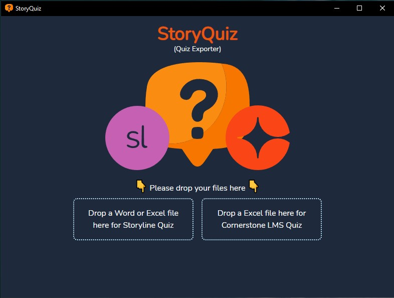

# StoryQuiz

A desktop application that scans Word and Excel files for quiz questions and exports them to formats compatible with Articulate Storyline or Cornerstone LMS.

## Features

- 🎯 **Multi-format Support**: Process Word (.doc, .docx) and Excel (.xls, .xlsx, .xlsm) files
- 🚀 **Drag & Drop Interface**: Easily drag multiple files into the drop zone
- 📤 **Multiple Export Formats**: Export to Storyline, Cornerstone, or JSON formats
- 💡 **User-friendly UI**: Modern interface built with Svelte and Tailwind CSS
- ℹ️ **App Information**: Click logo for app info, license for license details



## Tech Stack

- **Backend**: Go with Wails framework
- **Frontend**: Svelte with TypeScript
- **Styling**: Tailwind CSS
- **Build Tool**: Vite
- **Cross-platform**: Desktop app for Windows and Linux

## Prerequisites

### Arch Linux
```sh
pacman -S go
export PATH="$PATH:$(go env GOBIN):$(go env GOPATH)/bin"

# Install required system dependencies
pacman -Sy
pacman -S gtk3 webkit2gtk
```

## Installation

1. **Install Wails CLI**:
   ```sh
   go install github.com/wailsapp/wails/v2/cmd/wails@latest
   ```

2. **Clone and setup the project**:
   ```sh
   git clone <your-repo-url>
   cd storyquiz
   go mod tidy
   ```

3. **Install frontend dependencies**:
   ```sh
   cd frontend
   npm install
   cd ..
   ```

## Development

### Run in development mode
```sh
wails dev
```

### Build the frontend only
```sh
cd frontend
npm run build
cd ..
```

## Building

### Build for current platform
```sh
wails build
```

### Cross-platform build (Linux → Windows)
```sh
wails build -platform windows -o desktop
```

### Output locations
- **Linux executable**: `./build/bin/storyquiz`
- **Windows executable**: `./build/bin/storyquiz.exe` (or custom name specified with `-o`)

## Usage

1. Launch the application
2. Drag and drop Word or Excel files into the drop zone
3. Select your desired export format (Storyline, Cornerstone, or JSON)
4. The processed quiz questions will be exported to the specified format

## Troubleshooting

### `internal error: package "fmt" without types was imported`

Version mismatch between Wails CLI and project dependencies. Fix with:
```sh
go install github.com/wailsapp/wails/v2/cmd/wails@latest
go get github.com/wailsapp/wails/v2@latest
go mod tidy
```

### Error: `pattern all:frontend/dist: no matching files found`

Frontend not built:
```sh
cd frontend && npm run build && cd ..
```

## Project Structure

```
storyquiz/
├── app.go              # Main application logic
├── main.go             # Application entry point
├── go.mod              # Go module dependencies
├── wails.json          # Wails configuration
├── frontend/           # Frontend Svelte application
│   ├── src/
│   ├── dist/           # Built frontend assets
│   └── package.json
├── storyquiz/          # Core quiz processing logic
│   ├── quiz.go
│   ├── process_word.go
│   ├── process_excel.go
│   └── export_*.go
└── build/              # Build output directory
    └── bin/
```

## License

See [LICENSE.md](LICENSE.md) for details.
